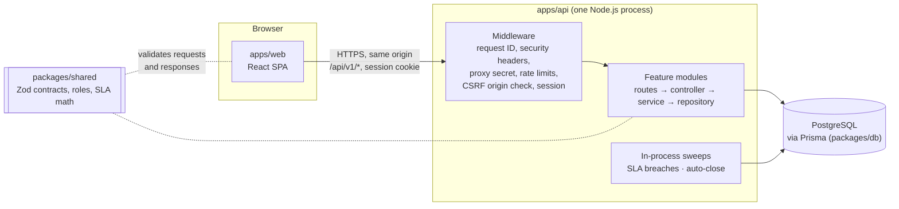

# PulseDesk

**PulseDesk is a multi-tenant customer support help desk** for small support teams: each
organization gets its own isolated workspace to work support tickets, keep customer history,
track service-level agreements (SLAs) and manage its team.

It's a full-stack TypeScript monorepo (React, Express, PostgreSQL, Prisma) built to
production standards: server-side sessions, role-based access control, tenant isolation
enforced in code **and** in the database, background SLA processing, and unit,
integration, end-to-end and accessibility tests in CI.

> **Status:** the agent-facing workspace, including a live dashboard and historical
> analytics, is implemented and tested end to end against PostgreSQL. Real-time updates, email
> (intake, delivery, password reset) and a customer portal are **planned, not built**. See
> [Roadmap](#roadmap). PulseDesk isn't deployed anywhere yet.

## Contents

- [Product overview](#product-overview)
- [Key capabilities](#key-capabilities)
- [Screenshots](#screenshots)
- [Architecture](#architecture)
- [Monorepo structure](#monorepo-structure)
- [Technology stack](#technology-stack)
- [Authentication and session security](#authentication-and-session-security)
- [Multi-tenancy and authorization](#multi-tenancy-and-authorization)
- [Tickets and customers](#tickets-and-customers)
- [SLA policies, breach detection and auto-close](#sla-policies-breach-detection-and-auto-close)
- [Team management and invitations](#team-management-and-invitations)
- [API overview](#api-overview)
- [Background jobs](#background-jobs)
- [Testing](#testing)
- [Local development](#local-development)
- [Environment variables](#environment-variables)
- [Database and migrations (local)](#database-and-migrations-local)
- [Package scripts](#package-scripts)
- [Security](#security)
- [Documentation](#documentation)
- [Roadmap](#roadmap)
- [Contributing](#contributing)
- [License](#license)

## Product overview

Support teams need one place to see every customer request, answer it, hand it to the right
person, and know which requests are about to miss a promised response time. PulseDesk models
that workflow for **many organizations in one installation**: every user signs in once, can
belong to several organizations with a different role in each, and never sees another
organization's data.

PulseDesk is currently an **agent-side console**: agents record tickets on behalf of
customers and work them inside the app. Messages to customers are stored but **not
delivered** anywhere, and customers can't open or reply to tickets themselves yet (email
intake and a customer portal are on the roadmap).

## Key capabilities

Everything listed here is implemented and covered by automated tests.

- **Accounts and organizations:** sign-up creates an organization (you're its owner, with a
  default SLA policy); sign-in, sign-out, session restore, and switching between
  organizations you belong to.
- **Roles:** Owner, Admin and Agent, enforced by the API with a single shared permission map.
- **Ticket inbox:** per-organization ticket numbers; filters by status, priority, assignee,
  team and tag, kept in the URL; cursor pagination; SLA badges.
- **Ticket detail:** public replies and internal notes, editable status, priority, assignee,
  team and tags, and a typed activity timeline (including system events).
- **Ticket lifecycle:** Open → Pending / On hold → Solved → Closed, enforced by one pure
  function; closed tickets are read-only.
- **Customers:** list and search, customer detail with ticket history, and editing.
- **Teams and tags:** create, rename and delete teams (with members) and tags;
  case-insensitive unique names.
- **Global search:** tickets and customers from the command menu (`Ctrl/⌘ K`).
- **SLA policies:** first-response and resolution targets per priority, editable by
  owners and admins; live SLA state (on track, at risk, breached, met) on every ticket.
- **Breach detection:** a background sweep records each SLA breach once, with a timeline
  event.
- **Auto-close:** per-organization setting that closes solved tickets after a quiet period.
- **Team management:** change roles, remove members, with last-owner protection.
- **Invitations:** single-use, expiring invite links for a given email and role, copied by
  the inviter and accepted by an existing or new account; revocable.
- **Live dashboard:** active tickets, tickets awaiting a first response, SLA health (the
  same states as the inbox badges) with the tickets that need attention, 30-day average
  first-response and resolution times, tickets by status, and workload by agent, all read
  from PostgreSQL per request. Owners and admins see the organization; agents see their own
  tickets. Definitions: [docs/architecture/dashboard.md](docs/architecture/dashboard.md).
- **Analytics:** trends over any range of up to a year (cut into days in the viewer's time
  zone): tickets created vs solved and reopened, first-response and resolution times
  (average and median), SLA compliance per target and priority, where new tickets are now,
  and per-agent solves, replies and first-reply times. Built from stored ticket history and the
  ticket timeline; nothing is pre-aggregated. Definitions:
  [docs/architecture/analytics.md](docs/architecture/analytics.md).
- **Audit trail (data only):** sensitive changes write audit-log entries; there is no UI to
  browse them yet.
- **UI:** accessible (WCAG 2.2 AA scans in CI), responsive app shell with a mobile drawer,
  light and dark themes, keyboard shortcuts, loading, empty and error states.

## Screenshots

There are no screenshots yet. Genuine captures of the running app will be added once the UI
is finalized; [docs/screenshots/README.md](docs/screenshots/README.md) lists the planned
screens (dashboard, inbox, ticket detail, customers, SLA policies, team, settings, light and
dark themes).

## Architecture



- The browser talks to **one origin**. In development Vite proxies `/api` and `/health` to the
  API; the planned production setup puts a reverse proxy (Vercel) in front of the API
  ([docs/deployment.md](docs/deployment.md)).
- Every API module follows the same layers: **routes** (path, middleware, validation) →
  **controller** (HTTP mapping) → **service** (business rules, tenant context) →
  **repository** (Prisma queries, always scoped by organization).
- Request and response shapes are **Zod schemas in `packages/shared`**: the API validates
  input with them and the web app validates every response with them.
- The SLA and auto-close sweeps run **inside the API process** on timers and stop cleanly on
  shutdown. There is no Redis, queue or separate worker today.

More detail: [docs/architecture/overview.md](docs/architecture/overview.md).

## Monorepo structure

```
apps/web          React SPA: app shell, pages, design system
apps/api          Express API: auth, tenancy, feature modules, SLA and auto-close sweeps
packages/shared   Zod contracts, error codes, roles & permissions, ticket lifecycle, SLA math
packages/db       Prisma schema, migrations, client factory with tenant guard, seed
e2e               Playwright end-to-end and axe accessibility tests
infra             SQL used by the optional Docker setup to create the test database
docs              Architecture and engineering guides
```

## Technology stack

| Layer    | Technology                                                                                                          |
| -------- | ------------------------------------------------------------------------------------------------------------------- |
| Frontend | React 19, TypeScript, Vite 8, React Router 8, TanStack Query, Tailwind CSS 4, Radix-based components, Framer Motion |
| Backend  | Node.js 24, Express 5, TypeScript, Zod, pino, helmet, express-rate-limit                                            |
| Database | PostgreSQL (15+; 17 in CI) with Prisma ORM 7                                                                        |
| Auth     | Server-side sessions in PostgreSQL, HttpOnly cookies, Argon2id password hashing                                     |
| Testing  | Vitest, React Testing Library, Supertest, Playwright, axe-core                                                      |
| Tooling  | pnpm workspaces, ESLint (type-aware, jsx-a11y), Prettier, GitHub Actions                                            |

No paid APIs or proprietary hosted services are required to run it.

## Authentication and session security

- **Passwords** are hashed with **Argon2id**. Sign-in for an unknown email still runs a
  dummy hash, so response timing doesn't reveal which accounts exist.
- **Sessions** are opaque, server-side and stored in PostgreSQL. The cookie holds a random
  256-bit token; the database stores only its **HMAC-SHA-256**, so a database leak doesn't
  yield usable sessions. Sessions have an idle timeout and an absolute lifetime, and
  sign-out revokes them immediately.
- **Cookies** are `HttpOnly` and `SameSite=Lax`; production requires the `__Host-` prefix and
  `Secure`.
- **CSRF:** state-changing requests must carry an allowed `Origin`, and bodies must be JSON.
- **Rate limits:** a global per-IP limit, failed sign-ins limited per IP **and** per email,
  sign-ups per IP, and failed invitation-link attempts per IP (in-memory store, for a single
  API instance).
- **Proxy secret:** in production the API only answers requests carrying a shared secret
  that the reverse proxy adds (except `GET /health`).

Not built yet: password reset and change, "sign out other devices", MFA.
Details: [docs/architecture/auth-and-sessions.md](docs/architecture/auth-and-sessions.md).

## Multi-tenancy and authorization

- One database and schema; every tenant-owned row carries `organizationId`.
- Isolation is enforced in **four layers**: the tenant context comes only from the
  session → repositories require `organizationId` (and a Prisma guard rejects unscoped
  queries) → **composite foreign keys** make cross-organization references impossible in
  the database → integration tests try to break it for every endpoint.
- Another organization's resources answer **404**, so their existence isn't revealed.
- **Roles:** Owners can do everything; Admins manage settings, teams, tags, SLA targets and
  members (but not owners); Agents work tickets and customers. The permission map lives in
  `packages/shared`, so the UI hides what the API would refuse; **the API is always the
  authority**.

PostgreSQL row-level security is planned as an extra layer, not implemented.
Details: [docs/architecture/data-model.md](docs/architecture/data-model.md).

## Tickets and customers

- Agents create a ticket for a customer (by email; the customer record is created or reused)
  with the customer's first message, subject and priority.
- **Statuses:** `OPEN`, `PENDING` (waiting on the customer), `ON_HOLD` (waiting on a third
  party), `SOLVED`, `CLOSED`. Allowed transitions live in one pure function shared by the API
  and the sweeps; solving stamps `solvedAt`, reopening clears it, and closed tickets accept no
  changes or messages.
- **Priorities:** Low, Normal, High, Urgent. Changing priority moves unmet SLA due dates.
- Every change writes a typed timeline event (who, what, from → to), marked `USER` or `SYSTEM`.
- Concurrent edits lock the ticket row, so each change sees fresh state.
- **Customers** are contacts, not users: list, search, detail with ticket history, and edit.

## SLA policies, breach detection and auto-close

- Each organization has a **default SLA policy** with first-response and resolution targets
  per priority (created at sign-up). Owners and admins edit it on the **SLA policies** page;
  agents see it read-only. New targets apply to **new tickets**.
- Due dates are set at creation in **calendar time**. First response is met by the first
  public agent reply; resolution by solving the ticket.
- Every ticket response includes its **live SLA state**, computed by the same function the
  sweep uses: `on_track`, `at_risk` (last 25 % of the window), `breached`, `met` or `none`.
- The **breach sweep** records each breach once (database-enforced), writes a `SYSTEM`
  timeline event, and is safe to repeat or restart.
- **Auto-close:** each organization can close `SOLVED` tickets automatically after a quiet
  period (default 4 days; on by default for new organizations). Closing writes a `SYSTEM`
  timeline event.

Planned: business-hours calendars, pausing the clock while a ticket is pending, multiple
policies and breach notifications.

## Team management and invitations

- The **Agents & teams** page lists members and their roles. Owners and admins change roles
  and remove members; admins can't modify owners or grant ownership, and the last owner can
  never be removed or demoted.
- **Invitations** are for one email and one role (Admin or Agent; ownership is never
  invited). Creating one shows a **single-use link once**; there is **no email delivery**, so
  the inviter shares it manually.
  - The token is 256 bits, travels in the URL fragment (`/invite#…`) so it never reaches a
    server log, and is stored only as an HMAC.
  - Links expire after **7 days**, can be revoked, and only the invited email can accept: an
    existing user signs in, a new person signs up from the link.
  - Re-inviting the same email replaces the open invitation.

## API overview

Application endpoints live under `/api/v1` and exchange JSON; the health probes are served at
the root (`/health`, `/health/ready`).

| Area           | Endpoints                                                                                                  |
| -------------- | ---------------------------------------------------------------------------------------------------------- |
| Health         | `GET /health` (liveness), `GET /health/ready` (database reachable)                                         |
| Auth           | `POST /auth/register`, `/auth/login`, `/auth/logout`, `/auth/active-organization`; `GET /auth/session`     |
| Organization   | `GET`, `PATCH /organization` (name, auto-close settings)                                                   |
| Members        | `GET /members`; `PATCH`, `DELETE /members/:userId`                                                         |
| Invitations    | `GET`, `POST /invitations`; `DELETE /invitations/:id`; `POST /invitations/preview`, `/accept`, `/register` |
| Tickets        | `GET`, `POST /tickets`; `GET`, `PATCH /tickets/:number`; `POST /tickets/:number/messages`                  |
| Customers      | `GET /customers`; `GET`, `PATCH /customers/:customerId`                                                    |
| Teams and tags | CRUD on `/teams` (plus team members) and `/tags`                                                           |
| SLA policy     | `GET`, `PUT /sla-policy`                                                                                   |
| Search         | `GET /search?q=`                                                                                           |
| Dashboard      | `GET /dashboard` (live metrics; organization scope for owners/admins, own tickets for agents)              |

**Errors** use RFC 9457 `application/problem+json` with a stable `code` (for example
`VALIDATION_FAILED`, `NOT_FOUND`, `RATE_LIMITED`, `TICKET_CLOSED`), a `requestId` that also
appears in the logs, and per-field errors for validation failures. Unknown errors become a
generic 500; stack traces are logged, never returned.

## Background jobs

The API process runs two periodic jobs on a shared scheduler (`apps/api/src/lib/periodic-job.ts`):

| Job              | Default interval | What it does                                                       |
| ---------------- | ---------------- | ------------------------------------------------------------------ |
| SLA breach sweep | 60 s             | Records first-response and resolution breaches, in bounded batches |
| Auto-close sweep | 300 s            | Closes quiet `SOLVED` tickets for organizations with auto-close on |

- The first run starts one interval after the server is listening; runs never overlap.
- Work is batched and bounded per run; anything left over is picked up by the next run.
- On `SIGTERM`/`SIGINT` the API stops accepting connections and drains in-flight requests
  (up to `SHUTDOWN_TIMEOUT_MS`), then the schedulers stop, a running sweep finishes its
  current ticket, and only then does the database connection close
  ([details](docs/architecture/overview.md#background-jobs-and-graceful-shutdown)).
- An interval of `0` turns a job off, and both are always off under `NODE_ENV=test`.
- The design assumes **one API instance**: more instances stay correct (row locks), but
  repeat the scanning work.

## Testing

| Layer             | Tools                                | Command                 |
| ----------------- | ------------------------------------ | ----------------------- |
| Unit / component  | Vitest, React Testing Library, jsdom | `pnpm test`             |
| API + database    | Vitest, Supertest, real PostgreSQL   | `pnpm test:integration` |
| End to end + a11y | Playwright, axe-core (WCAG 2.2 AA)   | `pnpm test:e2e`         |

- Integration tests run against a **real, disposable** PostgreSQL database and include
  cross-tenant tests and an allow/deny test for permission rules.
- E2E runs the production builds of the web app and API, with proxy-secret enforcement on,
  and scans pages in both themes for accessibility violations.
- CI runs format, lint, typecheck, unit, integration and E2E tests and the builds on every
  push to `main` and every pull request ([.github/workflows/ci.yml](.github/workflows/ci.yml)).

Details: [docs/testing.md](docs/testing.md).

## Local development

**Prerequisites:** Node.js 24, pnpm 11 (`corepack enable`), PostgreSQL 15+. Docker is optional.

```bash
cp .env.example .env              # PowerShell: Copy-Item .env.example .env
pnpm install                      # also generates the Prisma client
```

Create the local database role and databases once, as the PostgreSQL superuser:

```sql
CREATE ROLE pulsedesk LOGIN CREATEDB PASSWORD 'pulsedesk_dev_password';
CREATE DATABASE pulsedesk      OWNER pulsedesk;
CREATE DATABASE pulsedesk_test OWNER pulsedesk;
```

Or, with Docker: `pnpm services:up` starts PostgreSQL 17 with the same credentials and
creates both databases.

```bash
pnpm db:deploy                    # apply migrations to your local database
pnpm db:seed                      # two demo organizations; safe to re-run
pnpm dev                          # web → http://localhost:5173, API → http://127.0.0.1:4000
```

Sign in as a seeded user such as `maya@brightwave.test` with the development-only password
`pulsedesk-dev-password`, or create your own organization at `/signup`. The
[development guide](docs/development.md) lists every seeded account, Windows notes and
troubleshooting.

## Environment variables

[`.env.example`](.env.example) documents every variable, marks it **[used]** or
**[reserved]**, and contains only local placeholders. Copy it to `.env` (git-ignored). The
API validates its configuration at startup and lists invalid variables by name without
printing their values.

| Variable                      | Purpose                                                           |
| ----------------------------- | ----------------------------------------------------------------- |
| `DATABASE_URL`                | Development database                                              |
| `TEST_DATABASE_URL`           | Separate, disposable database for integration and E2E tests       |
| `SESSION_SECRET`              | Key for hashing session and invitation tokens (generate your own) |
| `WEB_ORIGIN`                  | Allowed browser origin(s) for the CSRF check                      |
| `API_HOST`, `API_PORT`        | API listen address                                                |
| `RATE_LIMIT_*`                | Global and sign-in rate limits                                    |
| `SLA_SWEEP_*`, `AUTO_CLOSE_*` | Sweep intervals and batch sizes                                   |

Production-only rules (proxy secret, `__Host-` cookie, HTTPS origins) are described in
[docs/deployment.md](docs/deployment.md). Never commit `.env` or real secrets.

## Database and migrations (local)

- The schema is [`packages/db/prisma/schema.prisma`](packages/db/prisma/schema.prisma);
  migrations are in `packages/db/prisma/migrations/`. Some constraints (composite keys,
  partial unique indexes, CHECKs) are hand-written SQL in the migrations, and documented in
  [docs/architecture/data-model.md](docs/architecture/data-model.md).
- `pnpm db:deploy` applies committed migrations to `DATABASE_URL`.
- `pnpm db:migrate` creates a new migration after you edit the schema (local only).
- `pnpm db:seed` loads demo data and refuses to run with `NODE_ENV=production`.
- `pnpm test:integration` **wipes** `TEST_DATABASE_URL` on every run; a guard only allows a
  local database named `pulsedesk_test`.

## Package scripts

| Script                                                                    | What it does                                                    |
| ------------------------------------------------------------------------- | --------------------------------------------------------------- |
| `pnpm dev` · `dev:web` · `dev:api`                                        | Run web and API together, or one of them                        |
| `pnpm check`                                                              | Quality gate: format check, lint, typecheck, unit tests, builds |
| `pnpm format` · `format:check`                                            | Prettier write / verify                                         |
| `pnpm lint` · `lint:fix`                                                  | ESLint with zero warnings allowed                               |
| `pnpm typecheck`                                                          | `tsc --noEmit` in every workspace                               |
| `pnpm test` · `test:integration` · `test:e2e`                             | Unit/component, database integration, and Playwright tests      |
| `pnpm build`                                                              | Production builds (`apps/api/dist`, `apps/web/dist`)            |
| `pnpm db:generate` · `db:migrate` · `db:deploy` · `db:seed` · `db:studio` | Prisma client, migrations, seed and Prisma Studio               |
| `pnpm services:up` · `services:down`                                      | Optional Docker PostgreSQL                                      |

## Security

- Security practices: hashed sessions and passwords, `__Host-` cookies, CSRF origin checks,
  rate limits, strict input validation, tenant isolation in code and database, hashed
  single-use invitation tokens, a strict CSP on API responses, a same-origin-only CSP with
  HSTS and cross-origin isolation headers on the web app
  ([details](docs/deployment.md#spa-security-headers-web)), and redaction of cookies,
  tokens and secrets in logs.
- **Found a vulnerability?** Please report it privately; see [SECURITY.md](SECURITY.md).

## Documentation

| Document                                                            | Contents                                                                  |
| ------------------------------------------------------------------- | ------------------------------------------------------------------------- |
| [Architecture overview](docs/architecture/overview.md)              | Current architecture, layering, cross-cutting concerns, decisions, status |
| [Data model & tenant isolation](docs/architecture/data-model.md)    | Entities, ticket lifecycle, SLA clocks, isolation layers, constraints     |
| [Authentication & sessions](docs/architecture/auth-and-sessions.md) | Session lifecycle, cookies, CSRF, RBAC, invitations, abuse protection     |
| [Live dashboard](docs/architecture/dashboard.md)                    | Dashboard API, metric definitions, scope, queries, limitations, tests     |
| [Analytics](docs/architecture/analytics.md)                         | Analytics API, metric definitions, scope, buckets, queries, limitations   |
| [Development guide](docs/development.md)                            | Setup, seed data, commands, environment, troubleshooting                  |
| [Testing strategy](docs/testing.md)                                 | Test layers, suites, test database lifecycle, CI                          |
| [Coding conventions](docs/conventions.md)                           | TypeScript, naming, API design, layering, git workflow                    |
| [Design system](docs/design-system.md)                              | Tokens, components, layout, motion, accessibility                         |
| [Deployment (planned)](docs/deployment.md)                          | Future Vercel + Render + Neon setup, migrations, verification, rollback   |

## Roadmap

**Implemented:** everything under [Key capabilities](#key-capabilities).

**Planned** (not built):

- **Analytics extras:** period-over-period comparisons, business-hours time, CSV export,
  and history-accurate attributes (priority and assignee at the time, replayed from the
  timeline).
- **Account self-service:** profile, password change and reset, "sign out other devices".
- **Organization lifecycle:** leave an organization, transfer ownership, delete an organization.
- **Audit-log viewer** for owners and admins (entries are already recorded).
- **SLA:** pausing clocks while pending, business-hours calendars, breach notifications.
- **Email:** invitation and password-reset emails, customer email intake and reply delivery.
- **Real-time updates** (Socket.IO) and **Redis** for shared rate limits and job queues.
- **PostgreSQL row-level security** as defense in depth.
- **Deployment** to Vercel, Render and Neon ([docs/deployment.md](docs/deployment.md)).

## Contributing

Contributions are welcome; [CONTRIBUTING.md](CONTRIBUTING.md) covers setup, checks, commit
conventions and pull-request expectations.

## License

[MIT](LICENSE) © 2026 [faiza-ijaz0](https://github.com/faiza-ijaz0)
