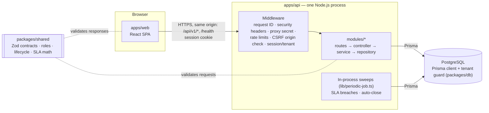
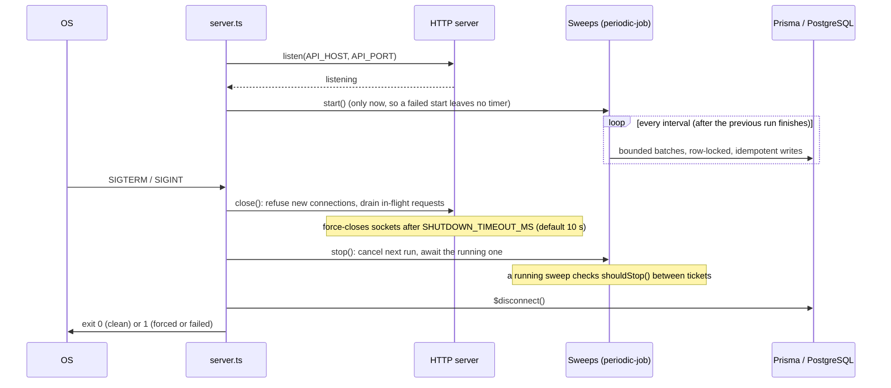

# Architecture Overview

> Status: the agent workspace (authentication, tenancy, tickets, customers, SLA processing,
> invitations and member management) is **implemented**. §1–§6 describe the architecture
> **as built**; planned additions (Redis,
> background queues, real-time updates, analytics) are marked as planned.
> [Implementation status](#implementation-status) lists what exists today.

## 1. System context

### As built



A request flows **web app → middleware → route → controller → service → repository →
PostgreSQL**. The SLA breach sweep and the auto-close sweep are timers inside the same API
process; they reuse the same repositories and the shared SLA and lifecycle functions.

### Planned additions (not built)

Redis (a shared rate-limit store, BullMQ queues for notifications and analytics rollups, and a
Socket.IO adapter), a Socket.IO server for real-time ticket updates, a separate worker
process, and email delivery. Until they exist, the API needs no service other than PostgreSQL.

The browser only ever talks to **one origin**. In development the Vite dev
server proxies `/api` and `/health` to the API; in the planned production setup a reverse
proxy (Vercel) does the same. Same-origin keeps the session cookie first-party and lets
us use `SameSite=Lax` without CORS credential gymnastics.

## 2. Monorepo layout

Package manager: **pnpm workspaces** (strict `node_modules`, fast, content-addressed store).
No extra build orchestrator (Turborepo/Nx) until build times justify one.

```
pulsedesk/
├── apps/
│   ├── web/                 # React + Vite SPA
│   └── api/                 # Express API, including the in-process SLA and auto-close sweeps
├── packages/
│   ├── shared/              # Zod schemas, DTO types, enums, error codes shared by web & api
│   └── db/                  # Prisma schema, migrations, generated client, seed script
├── e2e/                     # Playwright end-to-end suite (drives web + api together)
├── infra/
│   └── postgres/init/       # Dev-only DB bootstrap SQL (creates the test database)
├── docs/                    # Architecture, conventions, development & testing guides
├── docker-compose.yml       # Optional local PostgreSQL
├── .env.example             # Documented, credential-free environment template
├── package.json             # Root scripts that fan out to workspaces
└── pnpm-workspace.yaml
```

### Responsibilities

| Workspace         | Name                | Owns                                                                                        | Must not                                                  |
| ----------------- | ------------------- | ------------------------------------------------------------------------------------------- | --------------------------------------------------------- |
| `apps/web`        | `@pulsedesk/web`    | Routing, pages, UI components, client state, data fetching, theming, accessibility          | Contain business rules beyond UX validation; read secrets |
| `apps/api`        | `@pulsedesk/api`    | HTTP API, auth/sessions, RBAC, business logic, the SLA and auto-close sweeps                | Import anything from `apps/web`                           |
| `packages/shared` | `@pulsedesk/shared` | Request/response Zod schemas, inferred TS types, enums, `ErrorCode` union, permission names | Import Node-only or browser-only APIs; depend on Prisma   |
| `packages/db`     | `@pulsedesk/db`     | `schema.prisma`, migrations, Prisma client factory, seed data                               | Contain business logic; be imported by `apps/web`         |
| `e2e`             | `@pulsedesk/e2e`    | Playwright specs, fixtures, global setup (seeded tenants)                                   | Be imported by any other workspace                        |

**Why background work lives in `apps/api`:** the SLA breach sweep and the auto-close sweep
reuse the same repositories and shared functions as the HTTP layer. Today they run as timers
**inside the API process** (`lib/periodic-job.ts`), which is correct for the single API
instance PostgreSQL-only deployments need. When queues arrive (planned), the same code moves
behind a second entrypoint that runs as a **separate worker process**, without a premature
`packages/core` extraction.

**Why shadcn/ui components live in `apps/web`:** shadcn copies component source
into the app; there is only one consumer, so a `packages/ui` would be indirection
with no benefit.

## 3. Backend layering (`apps/api`)

Code is organized **by feature module**, each with the same internal layers:

```
apps/api/src/
├── server.ts                 # Entrypoint: HTTP server, sweeps, graceful shutdown
├── app.ts                    # Express app factory (no listen), used by server and tests
├── api-router.ts             # Wires repositories → services → controllers → routes
├── config/env.ts             # Zod-validated environment; the process exits on invalid config
├── http/
│   ├── middleware/           # request context, security headers, proxy secret, rate limits,
│   │                         # origin (CSRF) check, authenticate/requirePermission, errors
│   ├── errors.ts, problem.ts # AppError hierarchy and RFC 9457 problem+json responses
│   └── validate.ts           # Zod request validation
├── lib/                      # logger, clock, lifecycle (shutdown), periodic-job, transactions
└── modules/
    ├── auth/                 # register, login, logout, session lifecycle, password hashing
    ├── organizations/        # profile and auto-close settings
    ├── members/              # memberships and roles (members.policy.ts)
    ├── invitations/          # invite links: create, revoke, preview, accept, sign up
    ├── teams/  tags/  customers/  search/  health/
    ├── dashboard/            # live metrics (GET /dashboard): one read-only snapshot query set
    ├── tickets/              # inbox, detail, writes, messages, timeline (tickets.policy.ts)
    ├── sla/                  # breach sweep: repository, service, scheduler
    ├── sla-policies/         # default policy targets (GET/PUT /sla-policy)
    └── auto-close/           # auto-close sweep: repository, service, scheduler
```

Each feature module has the same files:

```
tickets.routes.ts       # path + middleware + validation wiring only
tickets.controller.ts   # maps HTTP ⇄ service call; no business rules
tickets.service.ts      # business rules; framework-agnostic; takes a TenantContext
tickets.repository.ts   # Prisma queries; always scoped by organizationId
tickets.policy.ts       # authorization rules beyond a single permission (where needed)
```

Dependency direction is strictly downward:

```
routes → controller → service → repository → Prisma
                         ↘ policy, shared functions (@pulsedesk/shared)
```

- **Controllers** never touch Prisma. **Services** never touch `req`/`res`.
  **Repositories** never make authorization decisions.
- Services receive a `TenantContext` (`{ organizationId, userId, role, requestId }`)
  built by middleware from the session. They do not read it from globals.
- Services and repositories are plain functions/classes with injected dependencies,
  so they are unit-testable without HTTP.

## 4. Cross-cutting concerns

| Concern              | Approach                                                                                                                                                                                                                                                                                                                                                                                          |
| -------------------- | ------------------------------------------------------------------------------------------------------------------------------------------------------------------------------------------------------------------------------------------------------------------------------------------------------------------------------------------------------------------------------------------------- |
| **Config**           | `config/env.ts` parses `process.env` with Zod once at startup; the app refuses to boot on invalid or missing values. The rest of the code imports the typed `env` object, never `process.env`.                                                                                                                                                                                                    |
| **Validation**       | Every route declares Zod schemas (from `@pulsedesk/shared`) for `params`, `query` and `body`. Unknown keys are stripped. The same schemas power client-side form validation.                                                                                                                                                                                                                      |
| **Errors**           | Services throw typed `AppError`s (`NotFoundError`, `ForbiddenError`, `ConflictError`, `ValidationError`, …) carrying a stable `ErrorCode`. One Express error handler maps them to `application/problem+json` responses with `requestId`. Unknown errors become a generic 500; stack traces are logged, never returned.                                                                            |
| **Logging**          | `pino` + `pino-http`, JSON in production, pretty in development. Every line carries `requestId`, and `userId` / `organizationId` once authenticated. Cookies, `Authorization`, passwords and tokens are redacted.                                                                                                                                                                                 |
| **Request IDs**      | Middleware accepts an inbound `X-Request-Id` only if it matches a safe pattern (UUID/≤64 URL-safe chars), otherwise generates a UUID. Echoed in the response header and attached to logs, errors and audit entries.                                                                                                                                                                               |
| **Security headers** | **API:** `helmet` with a strict CSP (`default-src 'none'`); `X-Powered-By` disabled. **Web app:** static headers in `apps/web/vercel.json`: a same-origin-only CSP (inline theme script allowed by hash, inline styles for Radix), HSTS, COOP/CORP `same-origin`, framing denied. Details and exceptions: [deployment.md](../deployment.md#spa-security-headers-web).                             |
| **Rate limiting**    | `express-rate-limit` with an **in-memory store** (correct for one API instance; a Redis store is planned before scaling out): a global per-IP limit, failed sign-ins per IP **and** per email, sign-ups per IP, and failed invitation-link attempts per IP.                                                                                                                                       |
| **CORS**             | Not needed in the same-origin deployment. If enabled, it is an explicit allowlist from `WEB_ORIGIN` with credentials — never `*`.                                                                                                                                                                                                                                                                 |
| **Real-time**        | **Planned, not built.** Socket.IO would authenticate the handshake with the same session cookie and checks `Origin`. Sockets join `org:{id}` and, after a policy check, `ticket:{id}` rooms. Servers emit only after the DB transaction commits. The Redis adapter lets the worker and multiple API instances emit.                                                                               |
| **Background jobs**  | **Built:** two periodic sweeps inside the API process (`lib/periodic-job.ts`): SLA breaches every 60 s and auto-close every 300 s by default. Runs never overlap, work is batched and bounded, every write is idempotent and row-locked, and shutdown waits for a running sweep. **Planned:** BullMQ queues for notifications and analytics, with jobs that carry only IDs plus `organizationId`. |
| **Time**             | All timestamps are UTC `timestamptz`. A `Clock` abstraction is injected into SLA code so tests can control time.                                                                                                                                                                                                                                                                                  |

### Background jobs and graceful shutdown

There is no separate worker process. `server.ts` builds two schedulers on the shared
`lib/periodic-job.ts` helper, the **SLA breach sweep** (`modules/sla/`) and the **auto-close
sweep** (`modules/auto-close/`), and runs them inside the API process.



- **Scheduling:** a job is scheduled only after the previous run finishes, so runs of one
  job never overlap in a process. Timers are `unref`'d, so a pending job never keeps the
  process alive by itself.
- **Enabling:** `SLA_SWEEP_INTERVAL_SECONDS` (default 60) and
  `AUTO_CLOSE_SWEEP_INTERVAL_SECONDS` (default 300); `0` turns a job off, and both are always
  off under `NODE_ENV=test`, where tests call the sweep services directly.
- **Failures:** a failed run is logged (a database outage as a `warn` "skipped" line) and the
  schedule continues. Log lines carry aggregate counts only, never customer content.
- **Scale:** correctness across processes comes from row locks and a unique index that allows
  one breach event per ticket and target, but the deployment assumes **one API instance**; more
  instances would repeat the scanning work (see D5 and [deployment.md](../deployment.md)).
- `unhandledRejection` and `uncaughtException` trigger the same shutdown with exit code 1.

## 5. Multi-tenancy and authorization

Summarized here; full details are in [data-model.md](./data-model.md) and
[auth-and-sessions.md](./auth-and-sessions.md).

- **Shared database, shared schema, `organizationId` on every tenant-owned row.**
- Isolation is enforced in **four layers**: session-derived tenant context →
  repositories that require `organizationId` → composite foreign keys that make
  cross-tenant references impossible in the DB → mandatory cross-tenant tests.
- **RBAC** roles per membership: `OWNER`, `ADMIN`, `AGENT`. Permissions are named
  (`ticket:assign`, `member:invite`, …) and mapped to roles in one table in
  `@pulsedesk/shared`, so the UI can hide what the API would reject. **The API is
  always the authority.**
- Resources from another organization return **404**, not 403, so their existence isn't revealed.

## 6. Frontend architecture (`apps/web`)

- **Routing:** React Router data routers; route-level code splitting; an
  authenticated layout route (`RequireAuth`) that loads `/api/v1/auth/session` and redirects
  to `/login` on 401.
- **Server state:** TanStack Query for caching, retries and invalidation; every response is
  validated against the shared Zod schema. (Planned: Socket.IO events will invalidate or patch
  query caches, never a second source of truth.)
- **Forms:** controlled React forms validated with the shared Zod schemas.
- **UI:** Tailwind CSS v4 with CSS-variable design tokens; shadcn/ui (Radix
  primitives) for accessible components; Framer Motion for meaningful transitions
  only, and it honors `prefers-reduced-motion`.
- **Theming:** light/dark/system via a `class` on `<html>`, set before first paint to
  avoid a flash; persisted in `localStorage`.
- **Accessibility target:** WCAG 2.2 AA — keyboard-navigable, visible focus,
  labelled controls, live regions for status messages, contrast checked in both themes.

## 7. Key decisions

| #   | Decision                                                                  | Alternatives considered                  | Rationale                                                                                                                                                                                                         |
| --- | ------------------------------------------------------------------------- | ---------------------------------------- | ----------------------------------------------------------------------------------------------------------------------------------------------------------------------------------------------------------------- |
| D1  | pnpm workspaces, no Turborepo yet                                         | npm workspaces, Nx, Turborepo            | Strict deps and speed; a build orchestrator is unnecessary at 4 packages                                                                                                                                          |
| D2  | Opaque server-side sessions in Postgres                                   | JWT in cookies, Redis sessions           | Instant revocation, simple mental model, auditable; Postgres is already the source of truth                                                                                                                       |
| D3  | Shared schema + `organizationId` + composite FKs                          | Schema-per-tenant, DB-per-tenant         | Operationally simple, works with Prisma migrations; composite FKs give DB-level guarantees                                                                                                                        |
| D4  | Postgres Row-Level Security deferred                                      | RLS from day one                         | RLS with Prisma requires per-transaction `SET LOCAL` plumbing; planned as defense-in-depth once the repository layer is stable (see roadmap)                                                                      |
| D5  | Background work inside `apps/api`                                         | Separate `apps/worker` + `packages/core` | Avoids premature extraction. Today: timers in the API process (one instance). Planned: a second entrypoint run as a separate worker once queues exist                                                             |
| D6  | Same-origin deployment behind a proxy                                     | Separate API domain + CORS               | First-party cookies, `SameSite=Lax`, no credentialed CORS                                                                                                                                                         |
| D7  | Prisma 7 (stable line), not 8.0 RC                                        | Track `latest`                           | `prisma@latest` currently points to an 8.0 release candidate; we pin stable                                                                                                                                       |
| D8  | RFC 9457 problem+json errors                                              | Ad-hoc error shape                       | Standard, self-describing, carries `requestId` and `code`                                                                                                                                                         |
| D9  | TypeScript 6.0 and ESLint 9 (not TS 7 / ESLint 10)                        | Latest majors                            | TypeScript 7 (native port) does not expose the compiler API `typescript-eslint` needs (it supports `<6.1`); `eslint-plugin-jsx-a11y` does not support ESLint 10 yet. Revisit when both catch up.                  |
| D10 | Internal packages ship TypeScript source; the API is bundled with esbuild | Pre-compiling each package to `dist/`    | No build step or watch process for `@pulsedesk/shared`/`db` in development (Vite, tsx and Vitest consume `.ts` directly). The API's production bundle inlines workspace code and keeps npm dependencies external. |
| D11 | Liveness-only `GET /health`, mounted before rate limiting                 | Health check that pings PostgreSQL/Redis | A dependency outage must not make orchestrators restart healthy API processes. Readiness is separate: `GET /health/ready` checks PostgreSQL, sits behind the global rate limit, and answers 503 without details.  |
| D12 | In-memory rate-limit store for now                                        | Redis store immediately                  | Correct for one API instance and keeps Redis optional during development. Switches to a Redis store when Redis is introduced (needed before running more than one instance).                                      |
| D13 | Pin dependencies to releases at least one day old                         | Always newest                            | pnpm 11's `minimumReleaseAge` supply-chain policy; bypass entries are not committed.                                                                                                                              |

## Implementation status

| Area                                                                                                                                                                                                                        | Status                                                                     |
| --------------------------------------------------------------------------------------------------------------------------------------------------------------------------------------------------------------------------- | -------------------------------------------------------------------------- |
| Repository foundation, tooling (TypeScript, ESLint, Prettier), CI workflow                                                                                                                                                  | ✅ Built                                                                   |
| `packages/shared` — error codes, problem-details contract, roles & permissions, ticket enums, health contract                                                                                                               | ✅ Built                                                                   |
| `packages/db` — Prisma schema, initial migration, client factory with tenant guard, idempotent seed                                                                                                                         | ✅ Built (see [development.md](../development.md) for how it was verified) |
| `apps/api` — env validation, request IDs, structured logging with redaction, problem+json errors, helmet, CORS allowlist, rate limiting, Origin (CSRF) check, `GET /health`, graceful shutdown                              | ✅ Built                                                                   |
| `apps/web` — design system, app shell (sidebar, drawer, top bar, command menu, theme)                                                                                                                                       | ✅ Built                                                                   |
| `e2e` — Playwright journeys + axe WCAG 2.2 AA scans in both themes                                                                                                                                                          | ✅ Built                                                                   |
| Authentication (sign-up, sign-in, sign-out, session restore), organization switching, tenant context, RBAC, organization and member APIs                                                                                    | ✅ Built                                                                   |
| Invitations (single-use hashed links, 7-day expiry, invited email only) and member-management UI                                                                                                                            | ✅ Built                                                                   |
| Password reset                                                                                                                                                                                                              | ⏳ later (needs email delivery)                                            |
| Ticket read path: `GET /tickets` (filters, cursor pagination), `GET /tickets/:number` (conversation, internal notes, typed timeline), `GET /teams`, `GET /tags`; inbox and read-only detail UI                              | ✅ Built                                                                   |
| Ticket write path: `POST /tickets`, `PATCH /tickets/:number`, `POST /tickets/:number/messages`, lifecycle rules, typed timeline events; ticket creation, editable properties and composer UI                                | ✅ Built                                                                   |
| Directory and settings: customers (list, search, detail, edit, ticket history), team and tag management, global search (`GET /search`, command menu), organization settings                                                 | ✅ Built                                                                   |
| Reliability review: lock ordering for concurrent writes, bounded transaction retry, write-endpoint authorization matrix, no-op writes skip audit                                                                            | ✅ Built                                                                   |
| Test-database safety: reset/E2E target guard (local `pulsedesk_test` only), migration SQL scanner, migration-upgrade test                                                                                                   | ✅ Built                                                                   |
| SLA data layer: breach markers, event actor type (`USER`/`SYSTEM`), auto-close settings and sweep indexes; `evaluateSla`                                                                                                    | ✅ Built                                                                   |
| SLA breach detection: default policy at sign-up, in-process breach sweep (single instance), computed `sla` in ticket responses, SLA badges in the inbox and ticket details                                                  | ✅ Built                                                                   |
| Auto-close: per-organization settings (API + settings UI), in-process sweep closing quiet solved tickets with a SYSTEM timeline event                                                                                       | ✅ Built                                                                   |
| SLA policy management (`/sla`): default policy targets per priority (`GET`/`PUT /api/v1/sla-policy`, audited), new tickets only, premium page with a read-only view for agents                                              | ✅ Built                                                                   |
| Live dashboard (`/dashboard`, `GET /api/v1/dashboard`): status, SLA health, response times and workload read from PostgreSQL; organization scope for owners/admins, own tickets for agents ([dashboard.md](./dashboard.md)) | ✅ Built                                                                   |
| Email delivery, Socket.IO, Redis/BullMQ, historical analytics, audit-log viewer, account self-service, PostgreSQL RLS                                                                                                       | ⏳ planned (see the README roadmap)                                        |
